# 全站 UI 标准与首批页面实施记录（2026-11-16）

status: partial
owner: frontend
scope: 本地合成环境；全站外壳、登录、今日工作、学校目录及必要的目录查询/分组保存；不合并、不部署。
changed: 青绿标准、共用组件、首批页面、服务端限量分页和分组原子保存、对应测试。
evidence: 下列自动检查、Founder 与 L3 浏览器实操、18 张截图。
not_run: 生产/共享环境、真实网站、爬虫、LLM、生产构建、未迁移页面全部深层业务流程、独立人工视觉验收。
risks_or_stop_conditions: 两项既有 lint 错误；L3 无首页权限的既有行为保留；观感须由项目负责人核对后验收。未放行下一票。

## 一、结论与范围

首批页面已按项目负责人与 Fable 确认的青绿风格重做；顾问先阅读、再按分组编辑，一次保存多项仍逐字段留履历。Founder 与 L3 均完成建校、修改、校址拆分、删除自己新增校址、履历恢复和两窗口冲突检查。冲突后的输入在重新读取后仍保留，可由顾问再次保存。旧学校列表、详情可用，三所旧合成学校仍在；旧选校未改、未修。

业务依据仍为 BR-BASELINE-20261115-v68（学校字段归属与校址维护细节收口）、BR-051（学校目录与数据变更）及未取代前序规则。样式模板只提供外观证据，不把示意学校、学生、数字或动作当成业务依据。只读了 `ui-style-c/README.md` 与六张 HTML；没有打开其中的远程字体链接。

应用分支从 `origin/rebuild/schools` 的 `6e4ffa2` 开始；文档分支从 `origin/main` 的 `0bf0d06` 开始。两者均为 `codex/ui-standard-first-pages`。应用最终提交为 `67ddf36`。本票目标仍是验收后合入应用集成分支，不是 main。没有新增依赖、没有变更数据库结构、权限、认证机制、既有路由或构建/部署配置。目录 GET 增加服务端分页与筛选，POST 增加同一事务内的分组提交：这是本票列表和分组保存所需的技术契约变化，不应描述成“只改 CSS”。

## 二、十一项结果

| 项目 | 结论 | 证据 |
|---|---|---|
| 1 标准文档 | 已落地：固定取值、各页做法、空/错/加载/确认/提示、后续必须复用共用组件 | 应用 `docs/implementation/UI_STANDARD.md`，已登记 `docs/README.md` |
| 2 共用组件与变量 | 已落地：页头、主色区、卡片、三类按钮、标签、资料、输入/下拉、搜索/快捷筛选、表格/分页、分页签、进度、空态、提示、确认框 | `components/ui/standard.tsx`、`standard.css`；组件渲染与对比度测试 3 项通过 |
| 3 顶部外壳 | 已替换侧栏呈现；现有菜单顺序、文字、权限不变，管理三项折入「管理」；目录未加入导航 | `components/layout/AppFrame.tsx`、`TopBar.tsx`；十项导航实操 |
| 4 登录 | 已重做左右品牌区与登录卡，手机上下排列；提交目标、账号密码字段、重复提交锁和认证分支保留 | 登录两个表单及页面；登录相关 7 项测试；两账号实操 |
| 5 今日工作 | 已按实际看板数据重做；没有伪造任务、时间、进度或完成操作 | `app/(erp)/today/page.tsx`；当前实际显示 2 宗案件、2 项未完成任务、20 项阻碍；不表示“今天到期” |
| 6 目录列表 | 已实现表格、名称搜索、学段快捷筛选、地区筛选、服务端分页，页头唯一主操作为新增 | 页面、目录 API/仓储；每页 20、接口上限 100；数据库测试验证不同页不重叠、先筛选后限量 |
| 7 详情与分组编辑 | 已实现阅读态、身份/办学特征/学费/住宿/校址分组；当前编辑卡描边，仅该组保存 | 两账号一次修改学段和性别；数据库验证两项产生两条履历、失败整体回退；两窗口保留草稿 |
| 8 固定选项 | 已使用本地名单实际取值加未知；旧值不丢失 | 下节清单；浏览器确认既有「合成學段」仍是当前选项，取消后保持原值 |
| 9 多校址 | 共用值显示一次，差异值各校址并排；称呼优先校址标识/地址/时段，否则历史顺序稳定编号 | `campusTitle`（校址显示名称）、查询在排除已删校址前计算序号；数据库验证增删后存续编号不变；双账号拆分电话 |
| 10 履历 | 弱化底色、默认收起、最近五条、按字段筛选、查看全部；恢复前确认 | 双账号恢复性别旧值，学段/电话不变；已删校址履历仍显示但恢复按钮禁用 |
| 11 长单行整理 | 已把本票触及的学校动作、页面、组件主要控制流展开；不做全仓库格式化 | 最终差异；原有行为与新增分组/分页行为分别测试 |

不引入组件库：原生控件与已有 React 足以表达标准，避免额外默认皮肤和依赖升级。字体声明 Noto Sans TC 并保留系统无衬线回退；没有联网取得字体，不保证本机已安装 Noto Sans TC。

标准中的“每页一个页头主按钮”与“编辑卡内主色储存”同时存在：阅读态主按钮在页头，编辑时隐藏页头主按钮，由当前编辑卡的储存承担主操作；模态框活动时背景不可操作。未更改指定颜色与形状，此解释提交负责人核对。模板里的简化导航称呼没有替换系统既有名称。未加入没有数据支撑的阶段进度。

## 三、本地名单选项（原样）

来源只读：`school-tracker/hk-school-platform/apps/crawler/output/edb_schools_20260610_enriched.xlsx`，`schools` 工作表，632 条数据记录、30 列。另一个 `edb_schools.xlsx` 只有表头，不能提供选项。只提取以下列的去重取值，没有把真实学校资料写入应用数据库。

| 资料 | 来源列 | 选项（全部另加「未知」） |
|---|---|---|
| 学段 | school_level / 學校級別 | 中學 |
| 学生性别类别 | student_gender / 就讀學生性別 | 女、男、男女 |
| 资助类别 | finance_type / 資助種類 | 官立、按位津貼、直接資助計劃、私立、私立獨立學校計劃、英基學校協會、資助 |
| 授课时间类别 | school_session / 學校授課時間 | 上午、下午、全日、夜校 |
| 地区 | district / 學校所在分區 | 中西區、九龍城區、元朗區、北區、南區、大埔區、屯門區、東區、沙田區、油尖旺區、深水埗區、灣仔區、荃灣區、葵青區、西貢區、觀塘區、離島區、黃大仙區 |

模板中未在该原件出现的其他学段未自行补入。既有不在上述选项内的值原样追加为该资料当前选项，未改写成未知。

## 四、样式稿有、当前首批页面没有支撑的内容（7 项）

| 项目 | 实际处理 |
|---|---|
| 全站搜索 | 既有顶栏也没有搜索行为；现在明确显示不可用，不伪造检索结果 |
| 首页逐条“今天要完成”的任务及其精确时间 | 当前看板接口给案件下一步和任务数量；主栏呈现案件下一步，未把案件当成任务，当前无下一步时显示空态 |
| 首页“標記完成”与逐条完成圆按钮 | 当前首页没有相应动作契约；不添加按钮。任务模块既有功能未改变，不声称全系统不能完成任务 |
| 今日到期/已完成/本周截止等示意统计口径 | 使用已有可查看案件、未完成任务、阻碍三个统计，不重命名为未提供的口径 |
| 案件精确进度百分比 | 没有已确认的数值映射，只有真实阶段标签；共用进度组件存在但首页未套用假数值 |
| “几天没有更新” | 当前看板投影未提供该计算依据，不显示示意天数 |
| 新目录的招生/申请与自动拉取内容 | 本票未接入招生或更新；不把模板按钮、时间表或旧学校抓取结果搬入新目录 |

## 五、验证结果

下列命令均在应用仓库，使用本机 Node 22、pnpm 10.34.4。数据库测试使用一次性本地 PostgreSQL 17，镜像已在本机、`--pull=never`，没有连接远程环境。

| 检查/命令 | 结果 |
|---|---|
| `node --conditions=react-server --test tests/integration/school-directory-structure-postgresql.test.ts` | 14 通过、0 失败（与下一组实际合并运行，共 30） |
| `node --conditions=react-server --test tests/unit/schools/manual-directory.test.ts tests/integration/school-directory-maintenance-postgresql.test.ts` | 16 通过、0 失败；含原有四等级权限、隔离、履历、并发，新加组提交/分页/稳定称呼 |
| `node --conditions=react-server --test tests/unit/schools/*.test.ts` 排除 `manual-directory.test.ts`，加下列六文件 | 66 通过、0 失败 |
| 上组附加文件 | `tests/integration/school-target-workflow.test.ts`、`school-change-workflow.test.ts`、`school-governance-workflow.test.ts`、`postgresql-resolved-school-transaction.test.ts`、`postgresql-school-target-repository.test.ts`、`tests/contract/school-target-route.test.ts` |
| `pnpm test:migration` | 11 通过、0 失败 |
| `pnpm test:architecture` | 25 通过、0 失败 |
| `pnpm db:baseline:check` | verified；76 源、77 生成文件，基线未改 |
| `node --conditions=react-server --test tests/migration/one-role-baseline.test.ts` | 28 通过、0 失败 |
| `pnpm test:one-role-baseline-postgresql` | 2 通过、0 失败；含真实本地基线安装和回退验证 |
| `pnpm typecheck` | 退出码 0 |
| `node --test tests/unit/auth/login-page.test.ts tests/unit/layout/workspace-shell.test.ts tests/unit/ui/standard.test.ts` | 18 通过、0 失败；渲染标签/未知与旧选项/禁用及提示语义，7 组文字颜色对比度均 ≥4.5:1 |
| `pnpm exec eslint` 本票全部变动 TS/TSX 与三个新增 TS/TSX 文件 | 两项既有错误，见下；新代码没有新增 lint 错误 |
| `git diff --check` | 通过 |
| 九账号密码只读核验 | 本地回环连接、既有 verifier 比对 9/9 匹配指定密码，未改密码 |

上述独立测试合计 180 通过、0 失败、0 跳过。最初旧页面源码断言依赖原控件标签和旧样式组件名，3 项失败；按新共用控件更新这些呈现断言，保留原认证字段、拒绝、权限和数据来源检查，最终全部通过。共用组件真实服务端渲染测试补充了标签绑定、旧值保留与禁用语义，不以删断言掩盖行为。

lint（代码规范检查）仍有：`app/(erp)/today/page.tsx` 的 `load()` 在 effect 内同步设状态；`components/layout/AppFrame.tsx` 的既有鉴权 effect 同步设状态。直接将 `origin/rebuild/schools` 对应源内容送入相同 ESLint 核对，均原已存在（外壳基线另有已随侧栏移除的导航收起 effect 错误）。不为此改变鉴权或业务加载行为，也不关闭规则。

### 浏览器逐步记录

| 操作 | Founder 实际结果 | L3 实际结果 |
|---|---|---|
| 登录/首页 | 登录成功，真实摘要与案件卡显示 | 登录成功，原权限拒绝首页；直达目录可进入。未放宽权限 |
| 新建学校 | 「合成青綠驗收學校」，默认一个校址 | 「合成青綠驗收L3」，默认一个校址 |
| 多项一次保存 | 学段中學、性别男女一次保存后显示 | 相同操作成功 |
| 加第二校址 | 显示校址 1、校址 2 | 相同操作成功 |
| 电话按校址分开 | 5550101 / 5550102 分别显示 | 5550301 / 5550302 分别显示 |
| 删自己新增校址 | 确认后校址 2 消失，校址 1 保留，最后校址禁删并说明 | 相同结果；已删校址旧电话履历保留 |
| 履历及恢复 | 筛选性别，确认恢复未知；学段与电话不受影响 | 相同结果，显示操作人 Local trial l3 |
| 停办/取消 | 标签出现/消失，资料仍显示 | 相同结果 |
| 两窗口冲突 | 后提交者收到原冲突提示，「合成衝突草稿保留」未丢；重新读取后仍在，再保存成功 | 「L3合成草稿」同样保留并重新保存成功 |
| 旧值与筛选 | 既有「合成學段」进入下拉仍为当前值，取消不变；中學筛选仅列两所符合学校；不存在名称得到空态 | 共用代码/数据库已验证；本轮未再重复筛选流程 |

Founder 顶部导航：今日工作、案件、学生与监护人、学校资料、任务、文件、审计记录、身份与权限、邮件设置、邮件范本十项均实际点击并观察加载后内容。案件两条、学生两条、任务两条、文件授权范围为空、审计记录、九账号管理列表和邮件配置/范本页面均可读；没有更改任何管理配置。旧学校显示 3/3，首所详情可读，未点击官网。

手机宽度 390px、桌面 1440px。手机目录、空态、首页和旧学校列表检查页面宽度未超 viewport；宽表在卡内滚动。模态框焦点进入取消/输入，原生控件可键盘操作；完整辅助技术及所有旧页手机深层交互未执行。九个本地账号密码均仍为 `123456`，仅用于本地。

## 六、截图（实际本地合成数据）

### 登录

桌面：

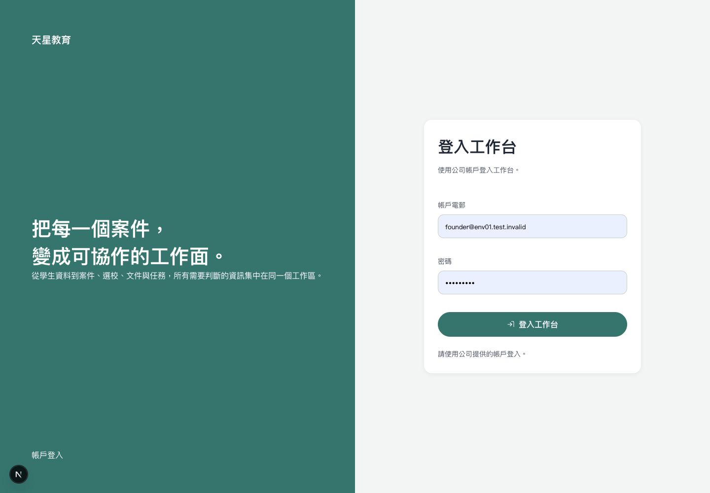

手机：

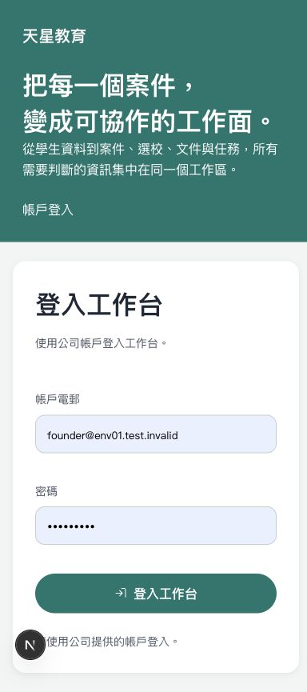

### 今日工作

桌面：

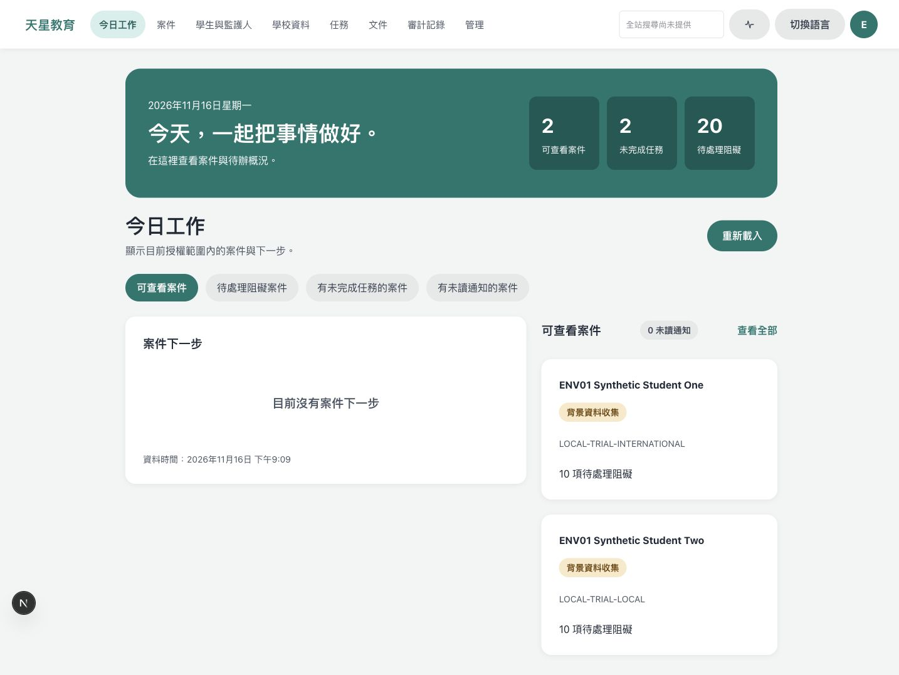

手机：

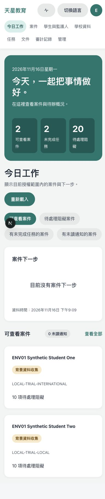

### 学校目录列表

桌面：

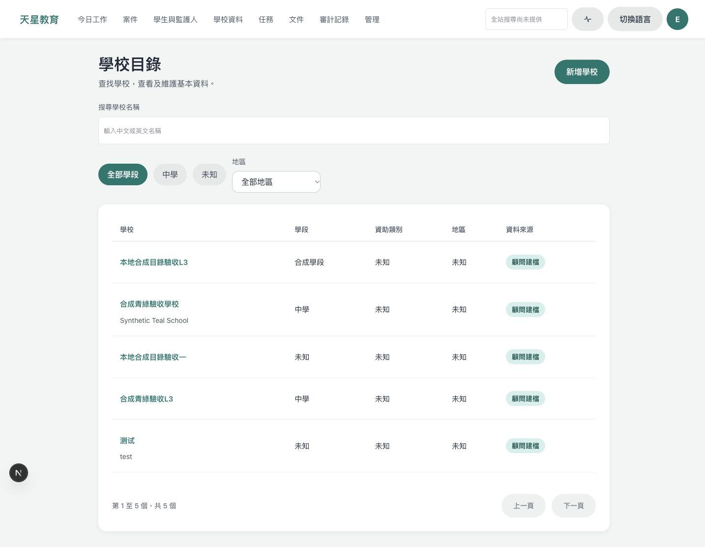

手机：

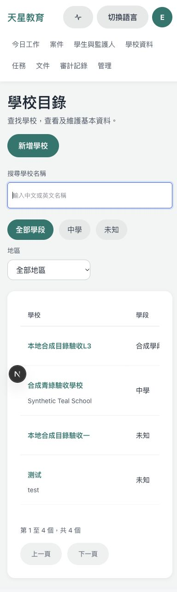

### 详情阅读

桌面：

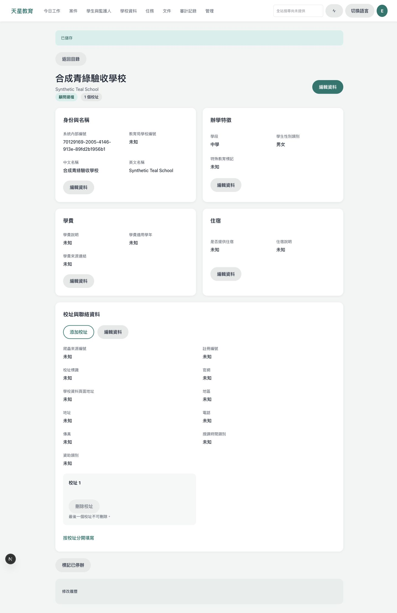

手机：

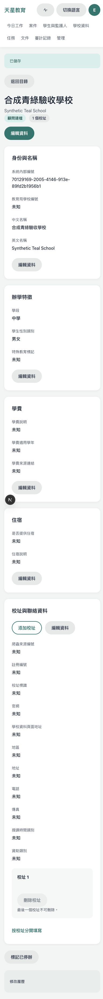

### 分组编辑

桌面：

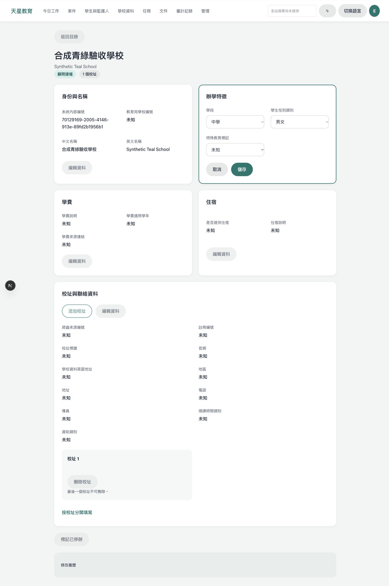

手机：

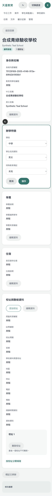

### 多校址对照

桌面：

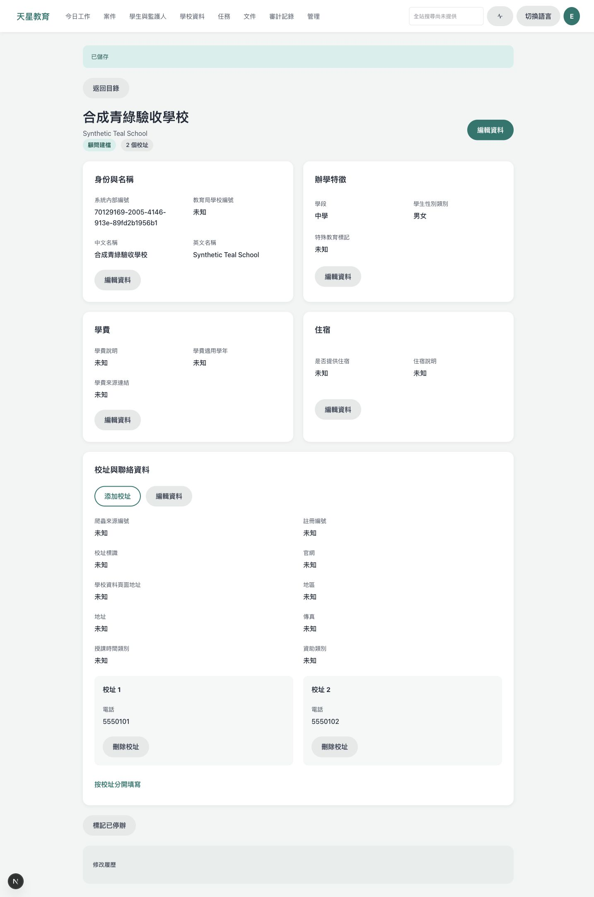

手机：

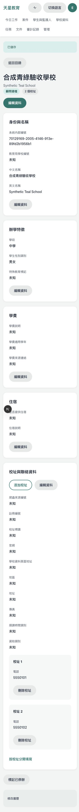

### 履历展开

桌面：

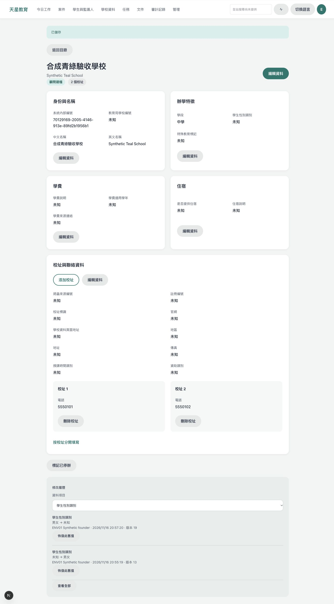

手机：

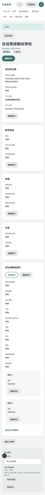

### 无匹配空状态

桌面：

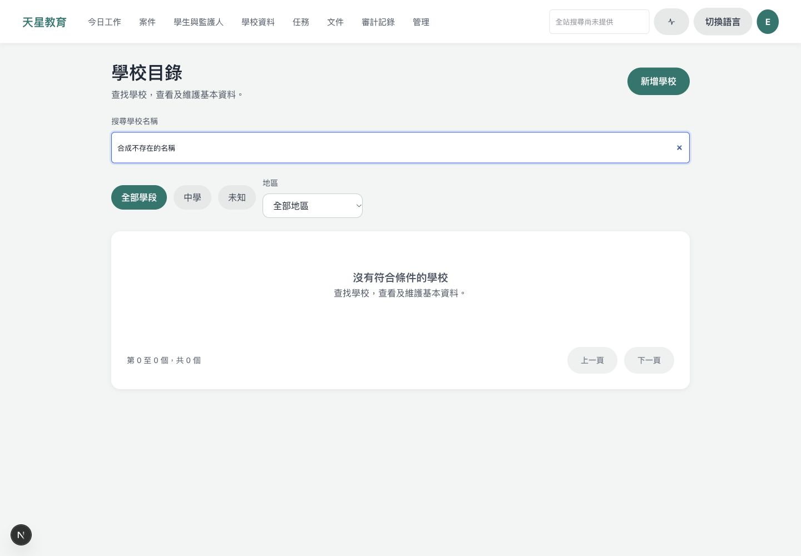

手机：

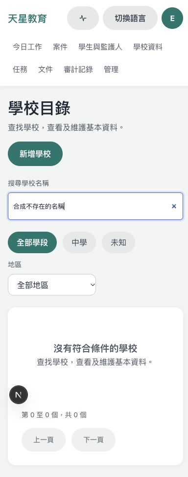

### 未迁移旧学校列表

桌面：

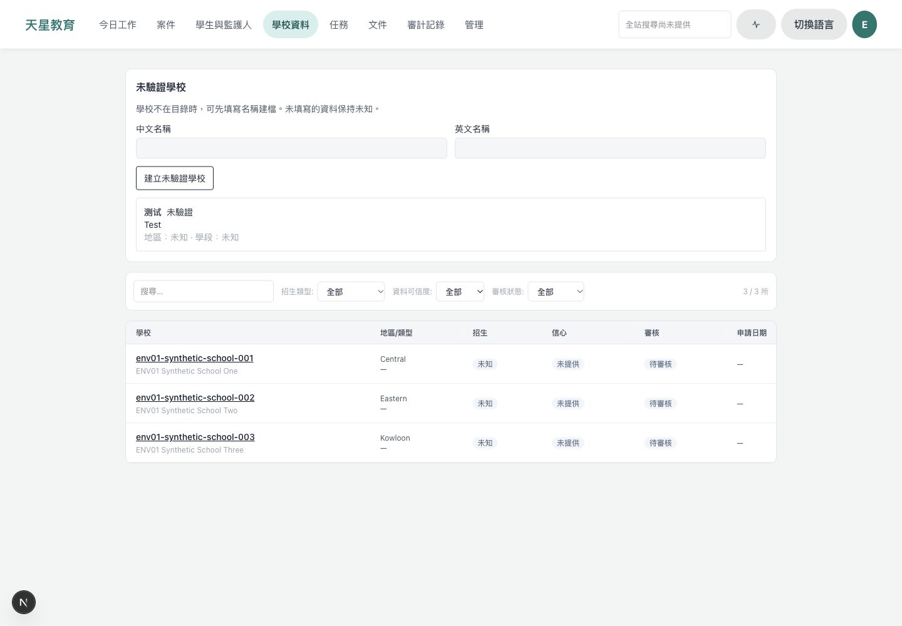

手机：

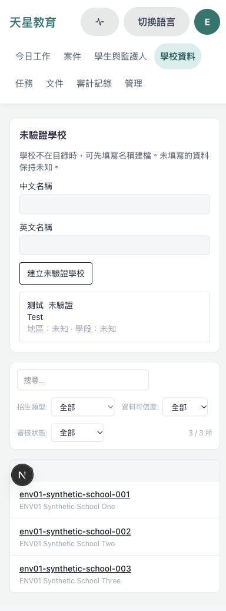

## 七、新增与调整的页面文案

下列新键同时登记中英文；原有键及含义均未改。旧登录正文、错误、字段名、学校动作/冲突文案保留。首页原「查看全部」入口保留，任务主栏改称案件下一步以免把案件当成真实任务。品牌由原顶栏工作台标题改为负责人指定「天星教育」；手机新增显示原有头像入口。管理入口文字仍取既有菜单。

| 新键 | 繁体中文 |
|---|---|
| `schoolDirectory.edit` | 編輯資料 |
| `schoolDirectory.identity` | 身份與名稱 |
| `schoolDirectory.features` | 辦學特徵 |
| `schoolDirectory.tuition` | 學費 |
| `schoolDirectory.boarding` | 住宿 |
| `schoolDirectory.campuses` | 校址與聯絡資料 |
| `schoolDirectory.campusFallback` | 校址 |
| `schoolDirectory.campusCount` | {{count}} 個校址 |
| `schoolDirectory.chooseField` | 資料項目 |
| `schoolDirectory.allFields` | 全部資料項目 |
| `schoolDirectory.viewAll` | 查看全部 |
| `schoolDirectory.listDescription` | 查找學校，查看及維護基本資料。 |
| `schoolDirectory.searchPlaceholder` | 輸入中文或英文名稱 |
| `schoolDirectory.all` | 全部學段 |
| `schoolDirectory.allDistricts` | 全部地區 |
| `schoolDirectory.school` | 學校 |
| `schoolDirectory.noMatches` | 沒有符合條件的學校 |
| `ui.brand` | 天星教育 |
| `ui.management` | 管理 |
| `ui.searchUnavailable` | 全站搜尋尚未提供 |
| `ui.pagination` | 第 {{from}} 至 {{to}} 個，共 {{total}} 個 |
| `ui.previous` | 上一頁 |
| `ui.next` | 下一頁 |
| `ui.cancel` | 取消 |
| `ui.confirm` | 確認 |
| `ui.todayGreeting` | 今天，一起把事情做好。 |
| `ui.todaySummary` | 在這裡查看案件與待辦概況。 |
| `ui.todayNext` | 案件下一步 |
| `ui.nextUp` | 接下來 |
| `ui.noDueTime` | 未設定日期 |
| `ui.openCase` | 查看案件 |
| `ui.noNextAction` | 目前沒有案件下一步 |
| `ui.complete` | 已完成 |
| `ui.current` | 進行中 |
| `ui.future` | 未開始 |

## 八、未迁移页面及过渡情况

这些页面内容仍用旧样式，只有内部页面外壳更换。实际访问的十个导航入口及旧学校详情没有发现因新外壳而不可用或明显遮挡，未做范围外最小修正。表内未逐页检查的项目不声称可用；旧选校既有故障仍未修复。外部门户、登录激活、开发 fixture 不改其业务内容；门户仍走独立外壳。

| 页面路径 | 本轮状态 |
|---|---|
| `app/(auth)/login/activate/page.tsx` | 未执行该页深层浏览器检查；内容未改 |
| `app/(erp)/admin/access/levels/page.tsx` | 未执行该页深层浏览器检查；内容未改 |
| `app/(erp)/admin/access/page.tsx` | 已打开、内容可读；仍旧样式 |
| `app/(erp)/admin/crawler/page.tsx` | 未执行该页深层浏览器检查；内容未改 |
| `app/(erp)/admin/email/page.tsx` | 已打开、内容可读；仍旧样式 |
| `app/(erp)/admin/email/templates/page.tsx` | 已打开、内容可读；仍旧样式 |
| `app/(erp)/admin/schools/page.tsx` | 未执行该页深层浏览器检查；内容未改 |
| `app/(erp)/audit/page.tsx` | 已打开、内容可读；仍旧样式 |
| `app/(erp)/cases/[caseId]/access/page.tsx` | 未执行该页深层浏览器检查；内容未改 |
| `app/(erp)/cases/[caseId]/applications/page.tsx` | 未执行该页深层浏览器检查；内容未改 |
| `app/(erp)/cases/[caseId]/assessment/page.tsx` | 未执行该页深层浏览器检查；内容未改 |
| `app/(erp)/cases/[caseId]/close/page.tsx` | 未执行该页深层浏览器检查；内容未改 |
| `app/(erp)/cases/[caseId]/documents/page.tsx` | 未执行该页深层浏览器检查；内容未改 |
| `app/(erp)/cases/[caseId]/interviews/page.tsx` | 未执行该页深层浏览器检查；内容未改 |
| `app/(erp)/cases/[caseId]/page.tsx` | 未执行该页深层浏览器检查；内容未改 |
| `app/(erp)/cases/[caseId]/workspace/page.tsx` | 未执行该页深层浏览器检查；内容未改 |
| `app/(erp)/cases/new/page.tsx` | 未执行该页深层浏览器检查；内容未改 |
| `app/(erp)/cases/page.tsx` | 已打开、内容可读；仍旧样式 |
| `app/(erp)/cases/reconstructions/[reconstructionId]/page.tsx` | 未执行该页深层浏览器检查；内容未改 |
| `app/(erp)/cases/reconstructions/new/page.tsx` | 未执行该页深层浏览器检查；内容未改 |
| `app/(erp)/contractor/tasks/[taskId]/page.tsx` | 未执行该页深层浏览器检查；内容未改 |
| `app/(erp)/dashboard/page.tsx` | 未执行该页深层浏览器检查；内容未改 |
| `app/(erp)/documents/page.tsx` | 已打开、内容可读；仍旧样式 |
| `app/(erp)/notifications/page.tsx` | 未执行该页深层浏览器检查；内容未改 |
| `app/(erp)/platform/billing/page.tsx` | 未执行该页深层浏览器检查；内容未改 |
| `app/(erp)/profile/page.tsx` | 未执行该页深层浏览器检查；内容未改 |
| `app/(erp)/referral-sources/[sourceId]/page.tsx` | 未执行该页深层浏览器检查；内容未改 |
| `app/(erp)/referral-sources/page.tsx` | 未执行该页深层浏览器检查；内容未改 |
| `app/(erp)/schools/[schoolId]/page.tsx` | 已打开、内容可读；仍旧样式 |
| `app/(erp)/schools/page.tsx` | 已打开、内容可读；仍旧样式 |
| `app/(erp)/selector/page.tsx` | 未执行该页深层浏览器检查；内容未改 |
| `app/(erp)/students/[studentId]/guardians/page.tsx` | 未执行该页深层浏览器检查；内容未改 |
| `app/(erp)/students/[studentId]/page.tsx` | 未执行该页深层浏览器检查；内容未改 |
| `app/(erp)/students/deletion-requests/page.tsx` | 未执行该页深层浏览器检查；内容未改 |
| `app/(erp)/students/duplicates/[candidateId]/page.tsx` | 未执行该页深层浏览器检查；内容未改 |
| `app/(erp)/students/duplicates/page.tsx` | 未执行该页深层浏览器检查；内容未改 |
| `app/(erp)/students/new/page.tsx` | 未执行该页深层浏览器检查；内容未改 |
| `app/(erp)/students/page.tsx` | 已打开、内容可读；仍旧样式 |
| `app/(erp)/tasks/[taskId]/page.tsx` | 未执行该页深层浏览器检查；内容未改 |
| `app/(erp)/tasks/page.tsx` | 已打开、内容可读；仍旧样式 |
| `app/(fixtures)/cases/__fixtures/workspace/page.tsx` | 未执行该页深层浏览器检查；内容未改 |
| `app/(portal)/portal/access/page.tsx` | 未执行该页深层浏览器检查；内容未改 |
| `app/(portal)/portal/workspace/page.tsx` | 未执行该页深层浏览器检查；内容未改 |
| `app/page.tsx` | 未执行该页深层浏览器检查；内容未改 |

## 九、最终文件清单（相对应用集成分支）

### 新增

- `components/ui/standard.tsx`
- `components/ui/standard.css`
- `modules/schools/domain/directory-options.ts`
- `docs/implementation/UI_STANDARD.md`
- `tests/unit/ui/standard.test.ts`

### 修改

- `app/(auth)/login/DatabaseTestLoginForm.tsx`
- `app/(auth)/login/InternalEmailLoginForm.tsx`
- `app/(auth)/login/page.tsx`
- `app/(erp)/school-directory/page.tsx`
- `app/(erp)/today/page.tsx`
- `app/api/v1/school-directory/route.ts`
- `components/layout/AppFrame.tsx`
- `components/layout/TopBar.tsx`
- `docs/README.md`
- `i18n/en.json`
- `i18n/zh-TW.json`
- `modules/schools/domain/manual-directory.ts`
- `modules/schools/infrastructure/manual-directory-client.ts`
- `modules/schools/infrastructure/manual-directory-repository.ts`
- `modules/schools/public.ts`
- `tests/integration/school-directory-maintenance-postgresql.test.ts`
- `tests/unit/auth/login-page.test.ts`
- `tests/unit/layout/workspace-shell.test.ts`
- `tests/unit/schools/manual-directory.test.ts`

文档仓库只新增本报告与同名目录 18 张 JPEG。学校选项来源仓库只读、零改动。用户的 `ui-style-c/` 原件及 `AGENTS.md` 保持未跟踪、不提交。工程文档路由只新增标准链接。

权限清单：无权限定义、路径授权、组织范围或数据库授权改动。外壳继续使用原 `visibleWorkspaceNavigation`（按能力筛选导航）和 `capabilityForPath`（路径能力检查）；API 与仓储继续校验原四等级试用身份、组织范围和幂等性。列表分页与成组事务不改变谁能查看/修改什么。

## 十、自己点一遍与剩余边界

1. 打开 `http://localhost:3000/login`，用 `founder@env01.test.invalid` / `123456` 登录。首页只呈现实际看板内容。
2. 地址直达 `http://localhost:3000/school-directory`，点击新增学校，只填写合成名称。目录不在导航中。
3. 点办学特征的编辑，选择中學与男女，点该卡唯一储存；回到阅读态，看两项即时生效。
4. 添加校址，展开低强调的「按校址分開填寫」，选择電話，分别填合成号码，一次储存后比较两个校址。删除刚加的校址会要求确认；最后一个不可删。
5. 展开修改履历，筛选性别，恢复旧值先看到确认框，确认后仅该项变化。
6. 两窗口打开同校：窗口甲进入编辑并输入；窗口乙标记停办；甲储存应提示冲突且保留草稿。甲重新读取后仍可检查并提交自己的输入。
7. 换 `l3@local.invalid` / `123456` 重复目录流程。L3 的首页拒绝是既有权限行为，不是本票放行的新首页权限。

未执行：生产构建/部署、共享环境、真实网络、爬虫、LLM、教育局导入、招生、更新、旧机制退出、旧选校修复、所有未迁移页面的深层流程、独立视觉验收。没有为截图伪造任务、学生、学校资料或统计；浏览器新增的两所学校明确为本轮合成验收数据。

停止点：L3“登录→首页”无法在不改权限的前提下成为成功业务流程，因此保留拒绝，未放宽权限；标准主按钮与编辑态操作位置的解释、未支持的七项模板元素交负责人核对。没有遇到必须新增业务默认值才能完成目录样式的情况。未知语言、身份对应、多官网更新等前序挂起规则未触碰。

无数据库重装或迁移，未清除三所旧合成学校、未搬运旧原件、未使用真实学校资料写库。一次性测试容器已删除；结束时只有 `tianxing-local-postgres-1`，数据卷只有 `tianxing-local_tianxing_postgres_data`。本轮临时日志清理后不留 /tmp 产物；本地应用仍运行，可登录、可点。

回退：本票未改变结构，可切回集成分支的应用版本；不要混用新分页接口与旧目录客户端。合成验收数据是正常维护产生的数据，不随代码回退删除。仍需负责人核对后另行合并，不执行下一张票。


## 视觉收尾（2026-11-16 续票）

本节是当前续票结果；前文为首票证据，旧截图与当时的学段选项记录保留。本轮页面调整已完成，自动测试 182 项通过、0 失败、0 跳过，类型检查通过。**status: partial**：观感待负责人核对；原生 PNG 截图受工具限制，不能宣称已消除截图色差；首页仍有一项既有 lint 错误。

```text
status: partial
owner: frontend
scope: 两仓库现有 codex/ui-standard-first-pages 分支；本地合成页面
changed: 阅读态减量、卡标题编辑、技术资料折叠、校址编辑态删除、搜索框优先级、真实昵称问候、登录间距；18 张新截图转存 PNG
not_run: 原生无损 PNG 捕获；线上验证、部署、合并；未重复上一票全部导航点击和两账号完整建校/恢复/双窗口流程
risks_or_stop_conditions: 截图颜色与计算值的差异未能确定具体捕获环节；不据此修改已确认色值。无权限、数据库或未答业务问题阻断。
```

### 九项逐条结果

| 项目 | 结果 | 本地证据与边界 |
|---|---|---|
| 1. 学段选项 | 已完成 | 按本轮负责人明确决定，固定「幼稚園、小學、中學」，另有「未知」；不再引用中学名单作为学段完整枚举。其余四组选项未改。L3 打开旧「合成學段」记录，阅读态原样显示，编辑下拉仍选中该旧值，没有写回替换。 |
| 2. 未填写资料 | 已完成 | 阅读态不逐项显示未知，卡底「尚有 N 項未填寫」；空值按既有 null/空字符串识别，布尔「否」仍展示。编辑态字段完整。N 统计卡内资料项，校址字段有任一校址未填即计一项，技术项在系统区单独计数；不是新增完整度状态。 |
| 3. 系统资料 | 已完成 | 内部编号、爬虫来源编号、资料页网址移到页底默认收起的「系統資料」。展开后可见真实内部编号；后两项仍可在原校址编辑表单填写，内部编号仍不可编辑。 |
| 4. 编辑入口 | 已完成 | 页头不再有编辑主按钮，五组资料的标题右侧为文字链接式按钮；进入编辑后才出现本组取消/储存。UI_STANDARD.md 已同步。 |
| 5. 校址区 | 已完成 | 共用值只显示一次，各校址小块仅显示已有的不同值；没有独有已填值时不渲染空小块。删除仅在编辑态，名单/最后校址禁删规则未变。L3 实际删除本次新增的合成校址 3，校址 1 的称呼不变；另一个未保存的地址草稿仍在，随后取消，没有写入。 |
| 6. 搜索框和主色 | 搜索已修正；截图色差未能确认 | 旧 globals.css 的属性选择器覆盖了新组件类。主色计算值正确；见下表。没有改全局旧控件规则或色值。 |
| 7. 今日工作 | 已完成 | 移除主色区下方重复标题/说明；重新载入为弱按钮。复用现有登录资料读取，实际问候「ENV01 Synthetic founder，今天一起把事情做好。」；昵称读取失败保留原通用问候，不编造姓名。L3 原本无首页权限的行为未变。 |
| 8. 登录间距 | 已完成 | 浏览器读取标语后说明段的 margin-top 为 12px；桌面/手机均已重拍。 |
| 9. 截图、测试与报告 | 部分完成 | 18 张重新捕获的图像全部提供 PNG 文件，见下方；接口只提供 JPEG，因此这些是新拍 JPEG 转存 PNG，不是原生无损 PNG，也不把转存说成色差修复。报告已追加，测试与类型检查实际重跑。 |

### 搜索框原因与计算样式

`app/globals.css` 的 `input[type="search"]` 比原 `.ui-search` / `.ui-top-search` 更具体，覆盖圆角、字体与内边距；原生搜索框并非没有读取 56px 高度。仅把共用组件选择器限定为 `.ui-field .ui-input`、`.ui-field .ui-search`、`.ui-field .ui-top-search`，并补同范围焦点色；不影响旧页面非共用控件。

| 浏览器读取项 | 修正前 | 修正后 |
|---|---|---|
| 目录搜索框 | 高 56px、圆角 6px、字 13px | 高 56px、圆角 999px、字 16px |
| 顶栏搜索框 | 高 44px、圆角 6px、字 13px | 高 44px、圆角 999px、字 16px |
| 目录焦点边框 | 旧全局焦点样式 | rgb(15, 118, 110) |
| 首页主色块 | rgb(15, 118, 110) | 同值，即 #0F766E |
| 登录主色区 | 未在本轮修改前读取 | rgb(15, 118, 110) |
| 登录说明与标语间距 | 本轮未记录修改前计算值 | 12px |

截图接口的两种捕获方式均返回 JPEG 编码，且现有图没有嵌入 ICC 色彩描述。截图中主色像素与计算色值存在差异，具体产生于哪一捕获/色彩转换环节**未能确认**；没有擅自调整 CSS 主色、重绘截图或按猜测套用色彩配置。PNG 文件只是本轮截图的像素转存，避免后续再次 JPEG 编码，不能恢复原始捕获中已经损失的信息。若验收要求原生无损 PNG，此项仍待支持该格式的截图渠道核对。

### 本轮实际验证

| 命令/操作 | 结果 |
|---|---|
| `node --conditions=react-server --test tests/integration/school-directory-structure-postgresql.test.ts tests/unit/schools/manual-directory.test.ts tests/integration/school-directory-maintenance-postgresql.test.ts` | 30 通过：结构 14、手工维护 16；0 失败/跳过 |
| 前文既有学校 66 项同一命令集合 | 66 通过、0 失败/跳过 |
| `pnpm test:migration` | 11 通过、0 失败/跳过 |
| `pnpm test:architecture` | 25 通过、0 失败/跳过 |
| `pnpm db:baseline:check` | verified：76 源、77 文件；本票未改基线 |
| `node --conditions=react-server --test tests/migration/one-role-baseline.test.ts` | 28 通过、0 失败/跳过 |
| `pnpm test:one-role-baseline-postgresql` | 2 通过、0 失败/跳过；一次性本地 PostgreSQL 17 |
| `node --test tests/unit/auth/login-page.test.ts tests/unit/layout/workspace-shell.test.ts tests/unit/ui/standard.test.ts` | 20 通过、0 失败/跳过；新增空值隐藏但保留否/0、完整卡计数、标题编辑入口渲染检查 |
| `pnpm typecheck` | 退出码 0 |
| `pnpm exec eslint` 本轮变动的五个 TS/TSX 文件 | 首页既有 `react-hooks/set-state-in-effect` 1 错误；其余四文件 0 错误。未关闭规则或改变既有业务加载逻辑。上票 AppFrame 错误不在本轮改动文件范围，未重跑该文件。 |
| Founder 浏览器 | 登录、实名问候、目录搜索/空结果、全部新学段、编辑多项一次保存、否值展示、加校址/独有电话对照、履历与系统区、旧学校三条合成记录均实际观察 |
| L3 浏览器 | 直达目录、阅读/编辑、技术字段仍可编辑、删除本轮新加合成校址、其他地址草稿保留后取消、最后校址禁删、旧学段保留；首页既有拒绝未变 |
| 1440×1000 与 390×844 响应式 | 九种状态均捕获；读取页面 scrollWidth 不大于 innerWidth，未出现页面级横向溢出 |

本轮未重复建校、逐字段恢复和双窗口冲突的浏览器流程，前票证据不冒充本轮；相关真实 PostgreSQL 回归已重跑。未改登录机制、权限、接口、数据库结构或后端写入规则。页面删除后只清理被删除校址的草稿，其余输入保留；测试的校址删除是合成资料的既有软删除，不是清除三所合成学校。

### 本轮文件清单与交付边界

应用仓库修改 9 个文件，无新增文件：

- `app/(erp)/school-directory/page.tsx`
- `app/(erp)/today/page.tsx`
- `components/ui/standard.tsx`
- `components/ui/standard.css`
- `modules/schools/domain/directory-options.ts`
- `i18n/zh-TW.json`
- `i18n/en.json`
- `docs/implementation/UI_STANDARD.md`
- `tests/unit/ui/standard.test.ts`

文档仓库修改本报告，新增同目录下 18 个 PNG；前票 18 张 JPEG 保留为历史证据。新增文案只有「尚有 {{count}} 項未填寫」「系統資料」及含当前昵称的问候语（两语种同时登记）。学段选项是本轮负责人明示授权的 UI 选择项，不推导身份、权限或名单导入规则。

应用本轮提交：`397eb60`；文档本轮提交为本报告及 18 张 PNG 所在提交。继续使用两仓库同名分支；不建 PR、不合并、不部署。不改另两处旧学校页面、选校、权限与数据库；不访问真实网站、不调用 LLM、不运行爬虫、不写真实学校资料。AGENTS.md 与 ui-style-c 未提交；school-tracker 零改动。一次性容器/临时文件清理，最终仅保留本地开发数据库卷；本地应用保持可登录、目录可操作。

### 视觉收尾截图（本轮重新捕获，PNG 转存）

以下桌面/手机各 9 张，共 18 张。图像未经重绘或调色；格式限制见上文。

#### 登录

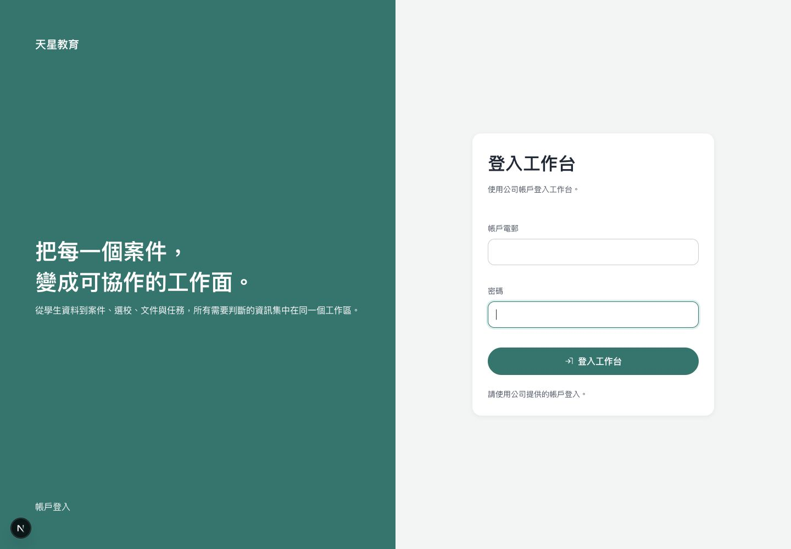

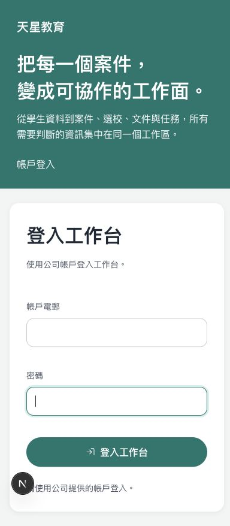

#### 今日工作

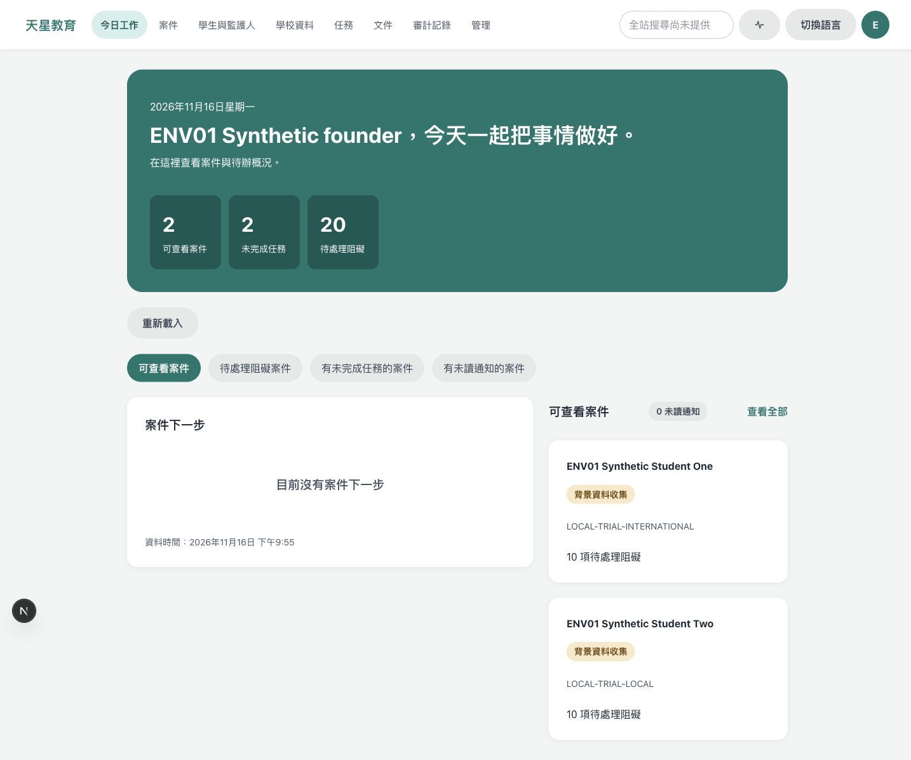

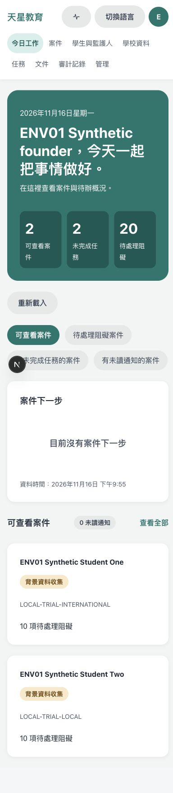

#### 学校目录

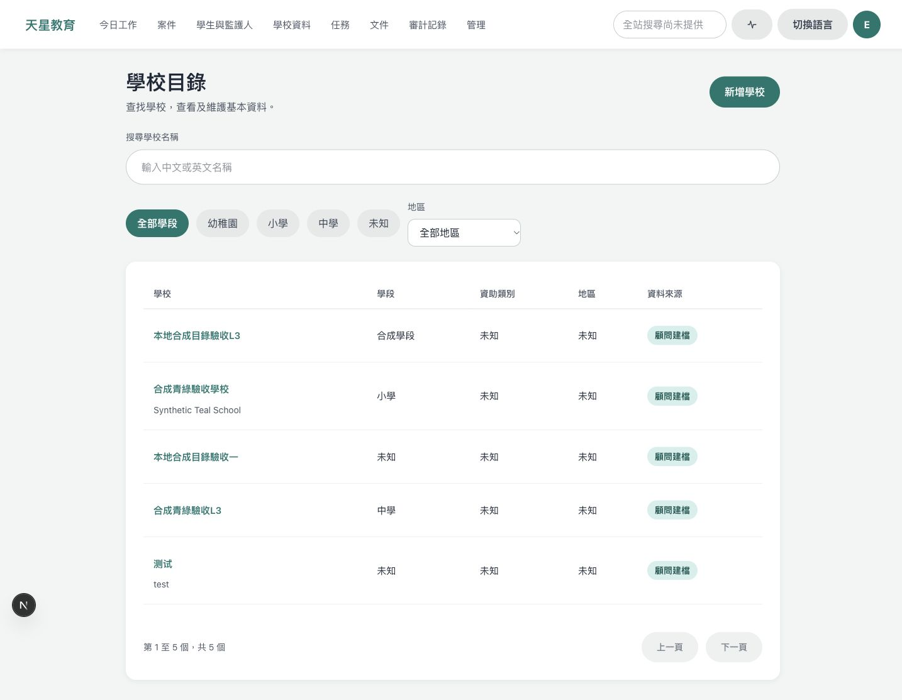

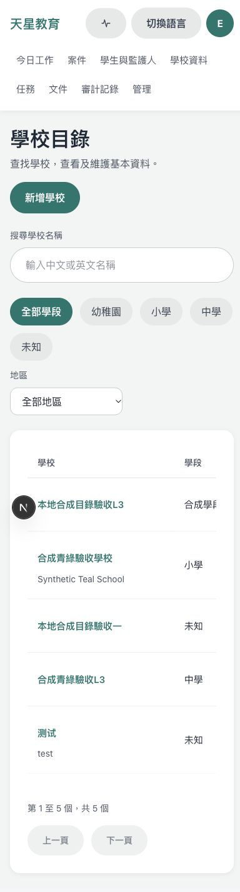

#### 详情阅读

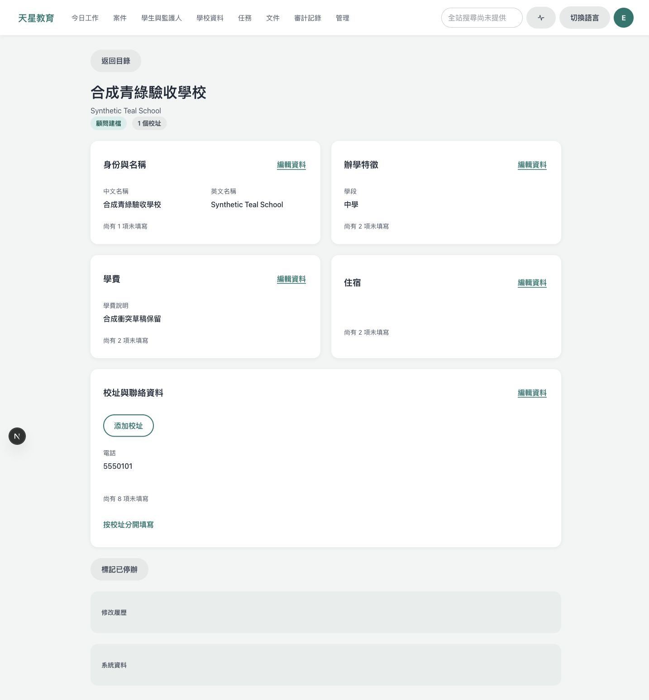

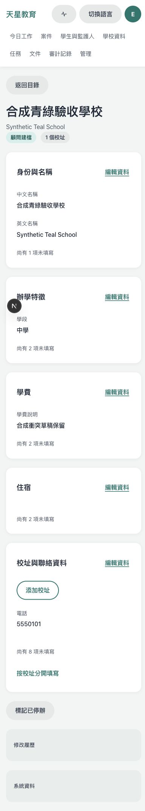

#### 编辑

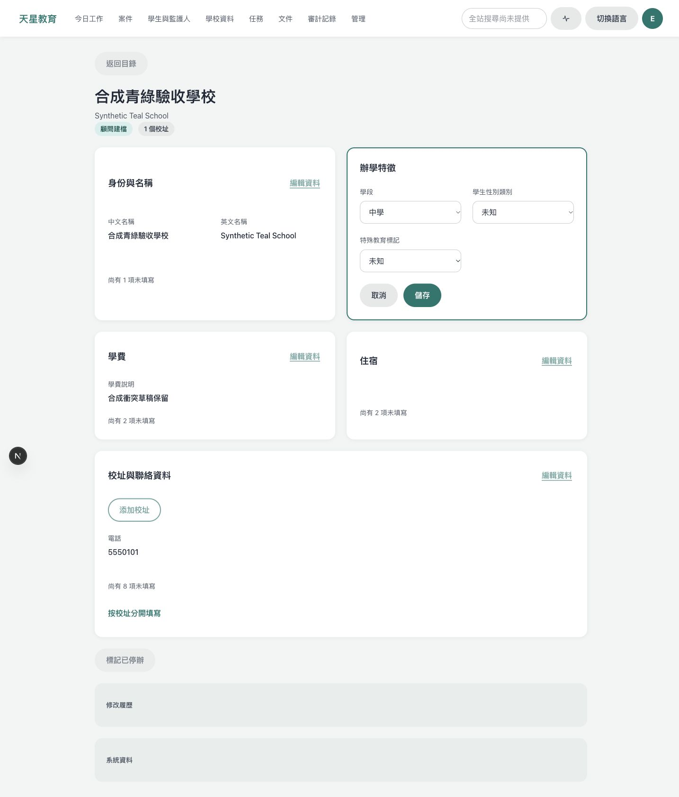

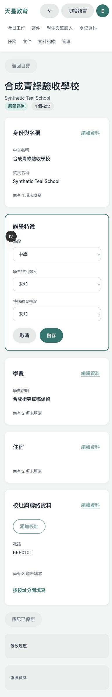

#### 多校址对照

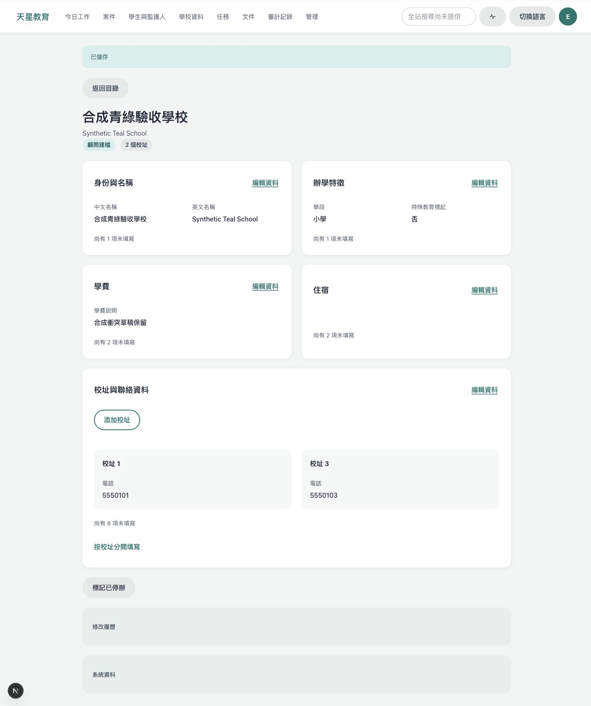

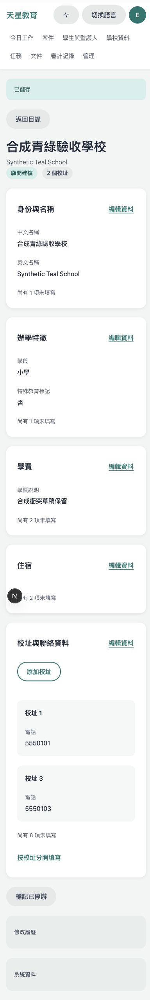

#### 履历展开

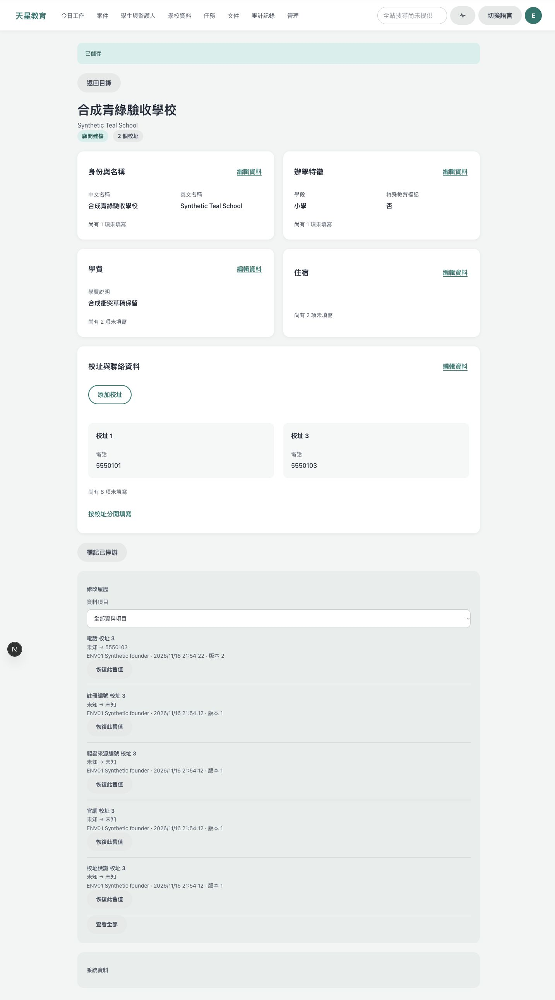

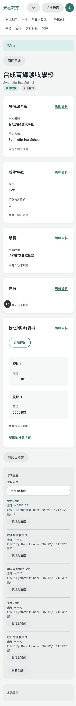

#### 空结果

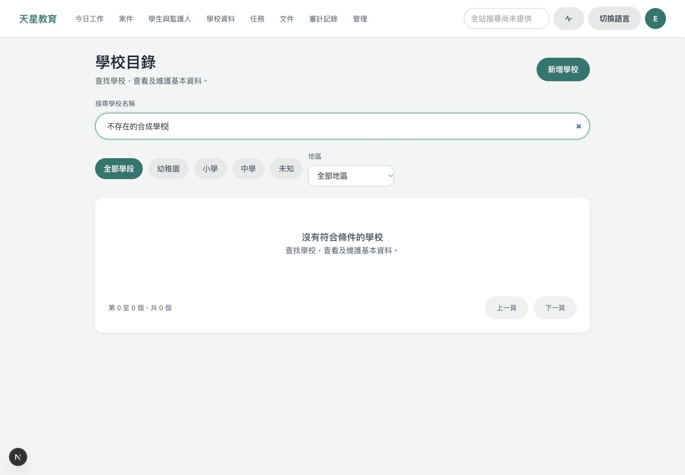

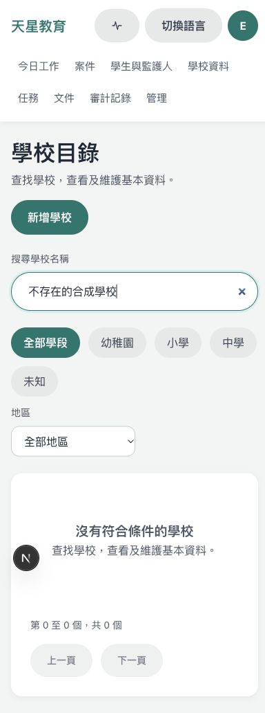

#### 旧学校页与新外壳

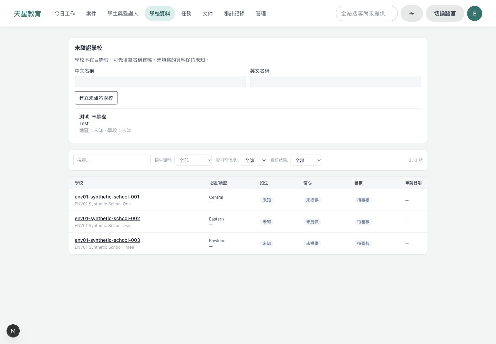


