# 学生、监护人与推荐来源 UI 标准实施记录

日期：2026-11-18。结论：外观改版与三处收尾已完成，可审阅；整票为 **partial**，不能宣称全部本地流程验收通过。学生搜索／筛选的现有接口不执行筛选，顾问建档被现有后端权限拒绝，疑似重复两页原本就是 404；推荐来源详情与删除审批操作缺少现有合成资料，未执行。以上均未绕过、未修订业务规则。

```text
status: partial
owner: frontend
scope: 本地学生、监护人、删除申请、推荐来源页面及三处共用呈现收尾
changed: 共用卡片、表格、输入、确认框、阅读与编辑状态；无接口和权限变更
evidence: 两账号浏览器实操、20 张截图、类型检查、定向 lint、回归与基线对照
not_run: 推荐来源详情和保存、实际删除审批、疑似重复处理；远程环境、部署、合并
risks_or_stop_conditions: 搜索筛选需接口另票；顾问建档需权限问题另票；不得据本票启用重复处理
```

## 1. 版本与边界

- 应用：从 `origin/rebuild/schools` 的 `e167d3a` 新开 `codex/ui-standard-students`；本票提交 `f8fd141`。
- 文档：从 `origin/main` 的 `eb41ae4` 新开同名分支；只新增本报告和同名截图目录。最终文档提交号见 Git 历史与交付回复。
- 依据：应用 `docs/implementation/UI_STANDARD.md`、共用组件与样式；文档 `design/ui-style-c/README.md`；`business-requirements/20-crm.zh-CN.md` 的现行 confirmed 条文。样式稿没有本批专门页面，未搬入其示例内容。
- 只访问 `http://localhost:3000`。复用运行中的本地程序与 PostgreSQL 容器，未重装数据库、未运行迁移或爬虫、未读任何 Neon 配置。没有新增依赖、升级工具链、修改构建部署设置。
- 验收只使用 `l2-international@local.invalid`（顾问）与 `l1@local.invalid`（管理员级），本地密码均为 `123456`。**本票没有使用 Founder 登录，没有占用或替换负责人 Founder 会话。** 截图中旧合成文件名称出现 Founder，不代表本票使用了该账号。

## 2. 页面结果与保存边界

| 范围 | 实际结果 | 证据位置（应用仓库） |
| --- | --- | --- |
| 学生列表 | 共用页头、搜索和状态筛选、白卡表格、名称加次要说明、状态标签、实际条数；无假分页。搜索与筛选控件保留，但接口不执行条件，见停止项 | `app/(erp)/students/page.tsx`；`components/crm/f2-contract.ts:195`；`app/api/v1/students/route.ts:25` |
| 新建学生 | 分组白卡、原必填标记、原监护人查询／查重步骤、唯一提交主按钮；L1 成功建档，顾问提交被拒绝 | `app/(erp)/students/new/page.tsx`；`components/crm/StudentCreateForm.tsx` |
| 学生详情 | 标题／状态、学生资料与监护人胶囊链接；空资料不逐项列出，零缺项不显示；编辑入口在标题右侧；学生和监护人分别整卡保存；系统资料收在底部 | `components/crm/StudentDetailView.tsx`、`ProfileEditPanel.tsx` |
| 监护人关系 | 当前关系卡；新建、关联已有、交接入口在卡标题右侧，展开才显示原表单；解除关系采用共用确认框 | `components/crm/GuardianRelationshipPanel.tsx`、`NewGuardianRelationshipForm.tsx` |
| 疑似重复列表／详情 | **未改，保持 404**。不能把已退役组件接回路由充当样式实现 | 两个 `app/(erp)/students/duplicates/**/page.tsx` 均直接调用 `notFound()` |
| 删除申请 | 共用卡片、筛选、空态；待处理行琥珀标签；申请／审批采用共用确认框并保留原确认勾选、提交锁、重试和重新载入限制 | `DeletionRequestsQueue.tsx`、`PendingDeletionRequestControl.tsx`、`DeletionDecisionControl.tsx` |
| 推荐来源列表 | 唯一新增主按钮、展开建立表单、白卡状态筛选／表格／条数；不新增现有接口没有的搜索或分页 | `ReferralSourcesDirectory.tsx` |
| 推荐来源详情 | 共用页头、卡片、阅读／编辑分离、编辑入口右上；版本和来源编号移入系统资料；没有真实打开已有来源的证据 | `ReferralSourceDetail.tsx` |

**保留原保存方式的范围：**学生与每名监护人原本各自整份资料保存，继续如此；监护人新建、关联、交接、解除仍是独立业务操作，不合成一个事务；推荐来源“修改资料”与“停用”仍不能同时提交，来源类型仍不可改；删除申请和审批仍独立提交。没有把这些独立操作变成跨卡一次保存。

对 8 个含写入操作的组件，以 TypeScript 语法树重新打印旧、新版本的 `submit`、`handleSubmit`、`mutate`、`submitCreate`、`search`、`lookupExistingGuardian` 函数进行对照，全部相同（忽略原有格式差异）。接口请求、验证、提交锁、幂等键、权威刷新逻辑未变。此对照是辅助证据，不替代浏览器验收。

现有角色／能力定义、路径授权、服务端、数据库结构与迁移均无改动。学生详情到监护人页面的链接仍只在原先允许管理且学生有效时出现；既有路由自身继续执行鉴权。

## 3. 三处收尾

| 项目 | 结果 | 验证 |
| --- | --- | --- |
| 零缺项不显示 | 共用 `MissingCount`（未填资料提示）在数量为零时不渲染；`FilledData`（已填资料展示）统一使用；学校校址汇总及评估独立汇总同步接入 | 单测覆盖零、非零、false 和数字零；案件文件页面原有两条“尚有 0 項未填寫”均消失 |
| 查看任务按钮 | 面试页“查看任務”保留原链接和次按钮，改为内容宽度 | 浏览器实际按钮宽 112px，父容器 1040px |
| 文件状态颜色 | 等待上传（含无版本）、待删除审核、拒绝、扫描失败、放弃采用琥珀；可使用保持主色，其他正常／历史状态保持原呈现；旧版本标签原有已删除警示色未改 | “等待上載”实际底色 `rgb(251, 232, 200)`、文字 `rgb(107, 65, 0)`；状态值与标签文字未改 |

## 4. 两账号浏览器实操

| 操作 | 顾问账号 | L1 账号 |
| --- | --- | --- |
| 登录 | 成功；可进入学生页 | 成功；可进入学生页 |
| 学生列表与搜索 | 输入 `ENV01` 后显示其可见学生；不能据此称搜索过滤通过 | 输入不可能匹配的合成名称仍返回全部 3 名学生，选择待删除也仍显示有效学生；确认接口问题 |
| 打开学生详情 | 成功，查看既有合成学生 One | 成功，查看既有合成学生 Two |
| 编辑保存 | 修改合成联系电话后出现“學生資料已儲存。”，阅读态显示新值 | 同样成功；版本仍由原逻辑维护 |
| 新建合成学生 | 填写明确标记合成的学生与监护人、先查询，再提交；被拒绝，无成功建档 | 同样步骤成功；建立“合成 UI L1 學生 1118”与其合成主要监护人，自动进入详情 |
| 监护人关系 | 成功打开现有关系；管理表单默认收起 | 成功打开；显示主要联系人及真实已有关系 |
| 疑似重复 | 列表显示 `Not Found` | 列表显示 `Not Found` |
| 删除申请队列 | 显示无权查看，原权限保持 | 空队列，显示共 0 笔 |
| 推荐来源列表 | 空列表，无管理入口 | 空列表；新增入口可见；有效状态筛选可操作 |
| 推荐来源详情／保存 | 无现有来源，未执行 | 无现有来源，未执行；未为验收造来源 |
| 删除确认框 | 未提交删除申请 | 打开学生申请确认框；未勾选时点击提交显示“請先勾選確認選項。”；取消后返回原详情，无删除申请写入 |

本票只新增了用户明确要求验证的 1 名合成学生及其必要主要监护人；顾问的建档请求被拒绝。未制造待审批、重复候选或推荐来源作为验收前置。没有执行批准删除、解除关系或交接等额外业务写入。

截图按 1440px 与 390px 视口拍摄；列表和来源页实测页面宽度不超过手机视口。共 20 张原生 JPEG（当前浏览器截图工具只提供 JPEG，没有将文件改后缀伪称 PNG）：14 张页面截图与 6 张收尾前后截图。疑似重复两张是实际 404 证据，不能作为该页 UI 完成证据。

## 5. 测试、基线对照与断言调整

命令在应用仓库执行，使用现有 Node 22.23.2、pnpm 10.34.4，无安装动作。

| 命令 | 本分支结果 | 基线对照／说明 |
| --- | --- | --- |
| `node --conditions=react-server --test tests/unit/crm/*.test.ts tests/unit/cases/*.test.ts tests/unit/documents/*.test.ts tests/unit/tasks/p3-fe-03.test.ts` | 357 项：345 通过、11 失败、1 跳过、0 无法收集 | 在 `e167d3a` 的独立归档副本、相同依赖和同一命令运行：345／11／1，失败名称完全一致，无新增失败 |
| `node --test tests/unit/ui/standard.test.ts tests/unit/ui/case-subpages.test.ts` | 16 通过、0 失败、0 跳过 | 含零缺项、确认禁用、文件提醒色测试 |
| `pnpm test:architecture` | 25 通过、0 失败、0 跳过 | 脚本实际执行 3 个架构边界文件 |
| `pnpm typecheck` | 退出码 0 | 非测试计数，不能写成若干测试通过 |
| `pnpm exec eslint <本票24个改动的ts/tsx文件>` | 退出码 0，0 错误／警告 | 明确列举 Git 差异中的文件；最后改动的确认组件与测试再次定向检查 |
| `git diff --check` | 通过 | 无空白错误 |

11 项失败逐项保留：

| 测试名称 | 原因／定位 |
| --- | --- |
| `allows review for Founder, Advisor and Data Reviewer while merge stays Founder-only` | 旧重复处理服务测试收到 `DUPLICATE_REVIEW_FORBIDDEN`；`duplicate-review-service.test.ts` |
| `candidate creation hashes only the canonical request and produces PII-free effects` | 同上，旧候选建立被拒绝 |
| `rejects invalid list enums before persistence` | 预期校验拒绝，实际先被旧重复处理授权拒绝 |
| `returns the repository candidate comparison pair without canonicalizing either profile` | 同上，读取比较对被拒绝 |
| `duplicate review entry and commands use capabilities only` | `duplicate-review-ui.test.ts` 的旧入口／能力源码断言与当前退役状态不一致 |
| `merge and correction preserve history, use synchronous locks and authoritative refresh` | 同一旧 UI 测试的源码断言失败；本票未改相应重复组件 |
| `parses only the frozen JSON aggregate and server command context` | `student-create-route-contract.test.ts` 的旧请求示例被当前契约判为无效 |
| `rejects unknown identity, organization, authorization and relationship fields` | 同文件拒绝码预期与当前契约不一致 |
| `P4 Case Documents route remains independent from Portal/Contractor` | P4（案件文件）旧断言要求 `DocumentWorkspace`，当前页面使用 `CaseDocumentsPanel` |
| `DOC-02 permanent browser gate owns real dependencies without committing a malicious signature` | DOC-02（文件上載、掃描與下載）旧断言仍要求 36 个生成文件，与已有基线数量不一致 |
| `Document routes use authoritative components and Case detail mounts the panel` | 旧文件目录组件名称断言与当前页面组件不一致 |

唯一跳过：`applies the additive document schema and exposes tenant, version, scan, and active-pointer constraints`，未设置 `TEST_DATABASE_URL`，没有把静态检查当作数据库证据。本票未改数据库，未为了跑该项连接其他数据库。

断言修改均保留原业务保护：

- `standard.test.ts`：把原“零缺项仍显示”的断言改为不显示；原非零、false 与数值零断言保留；补确认按钮禁用与非零计数测试。
- `profile-maintenance-ui.test.ts`：原生按钮改成共用按钮，相应标签断言更新；权限条件仍必须存在；提交锁正则只容纳换行。
- `pending-deletion-ui.test.ts`：只容纳展开格式后的空白与换行；有效状态、能力与提交锁断言仍在。
- `student-create-ui.test.ts`：原生下拉由共用 `FieldSelect` 包装，仍检查同一三个固定选项及无身份字段；提交锁断言容纳换行。
- `referral-source-ui.test.ts`：提交锁断言容纳换行，幂等与权威刷新断言不变。
- `case-subpages.test.ts`：增加文件状态配色测试；测试装载器补全 Next Link 的 Node 文件扩展名解析，不修改生产模块解析。

未运行全量测试、构建、旧浏览器自动化套件或远程验证；没有声称完成独立 QA。

## 6. 停止项、缺少功能与文字

1. **学生搜索／状态筛选**：原页面客户端带查询参数，但现有列表接口只按已验证身份列出学生，不读取参数。服务端和适配器在本票均未改；不能通过前端另加业务筛选掩盖接口差距。修复需接口另票。
2. **顾问建档**：页面能力允许打开表单，但后端 `postgresql-student-create-repository.ts:76` 的当前创建者校验仅允许 Founder／L1。顾问被拒绝与此一致。没有放宽权限，也没有把顾问建档记为通过。
3. **疑似重复**：两个现有路由直接返回 404；没有有效候选详情可打开。开启队列／合并不是样式工作，停在这里。
4. **缺现有资料**：推荐来源详情、保存、停用、删除审批的有数据状态未验证；未创建来源或删除请求来凑验收。监护人创建／关联／交接／解除的写入未执行，本票只验证打开和现有关系阅读。
5. **额外观察**：L1 登录后的今日工作显示“今日工作暫時無法使用”，学生模块仍能正常打开和保存；首页不在本票范围，原因未能确认，未修改。

样式稿有而系统未提供、因此未制作的内容：真实服务端分页；本次学生列表查询的实际过滤能力；可用疑似重复队列／详情。没有增加示例数字、进度、联系方式、候选或假翻页。

新增双语界面词集中于 `studentUi`（学生页面文字）：学生分区、学生资料、监护人关系、学生编号、资料版本、来源编号、共／笔。底部系统资料、缺项计数复用既有双语键。既有正文及操作提示原则上沿用；列表去掉与现有状态筛选矛盾的“待刪除資料不會列出”重复说明，保留原有“使用姓名或聯絡方式搜尋學生。”；监护人“次要聯絡人”改为既有需求中的“關聯監護人”，不改变关系或排序。没有新身份字段、权限、去重、合并、删除规则。

## 7. 文件清单

应用只修改下列 27 个已跟踪文件，无新增实现文件：

- `app/(erp)/school-directory/page.tsx`
- `app/(erp)/students/new/page.tsx`
- `app/(erp)/students/page.tsx`
- `components/cases/AssessmentEditor.tsx`
- `components/cases/InterviewInvitationsPanel.tsx`
- `components/crm/DeletionDecisionControl.tsx`
- `components/crm/DeletionRequestsQueue.tsx`
- `components/crm/GuardianRelationshipPanel.tsx`
- `components/crm/NewGuardianRelationshipForm.tsx`
- `components/crm/PendingDeletionRequestControl.tsx`
- `components/crm/ProfileEditPanel.tsx`
- `components/crm/ReferralSourceDetail.tsx`
- `components/crm/ReferralSourcesDirectory.tsx`
- `components/crm/StudentCreateForm.tsx`
- `components/crm/StudentDetailView.tsx`
- `components/documents/CaseDocumentCard.tsx`
- `components/documents/document-ui.tsx`
- `components/ui/standard.css`
- `components/ui/standard.tsx`
- `i18n/en.json`
- `i18n/zh-TW.json`
- `tests/unit/crm/pending-deletion-ui.test.ts`
- `tests/unit/crm/profile-maintenance-ui.test.ts`
- `tests/unit/crm/referral-source-ui.test.ts`
- `tests/unit/crm/student-create-ui.test.ts`
- `tests/unit/ui/case-subpages.test.ts`
- `tests/unit/ui/standard.test.ts`

文档新增：本报告与 `ui-standard-students.2026-11-18/` 下 20 张截图；既有报告、需求基线和设计稿不改。`school-tracker` 零改动。应用原有未跟踪 `AGENTS.md`、`ui-style-c/` 保留且不暂存、不提交。

## 8. 截图

### 学生列表

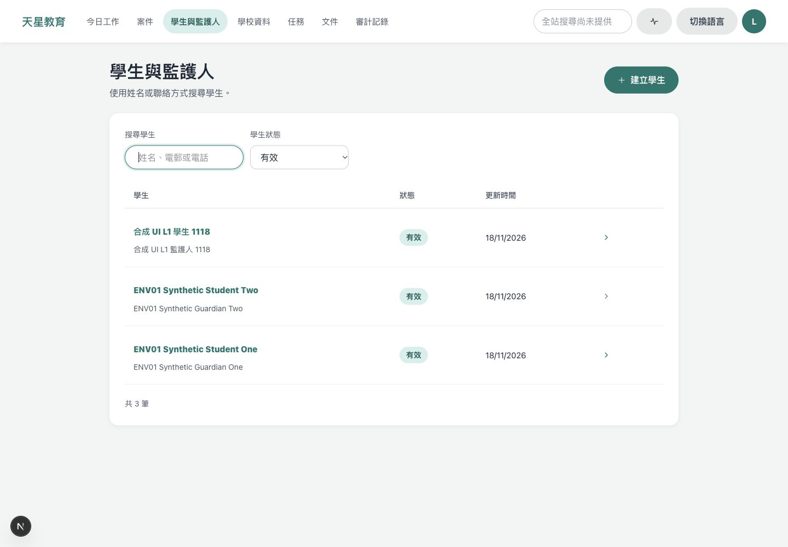

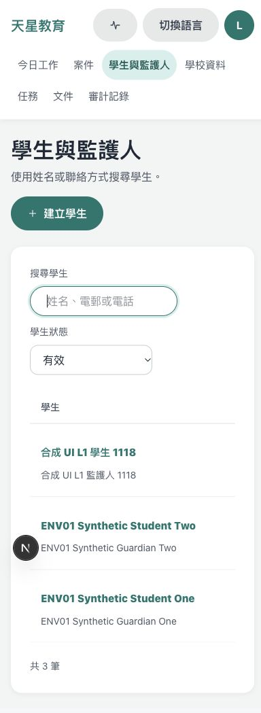

### 学生详情阅读态

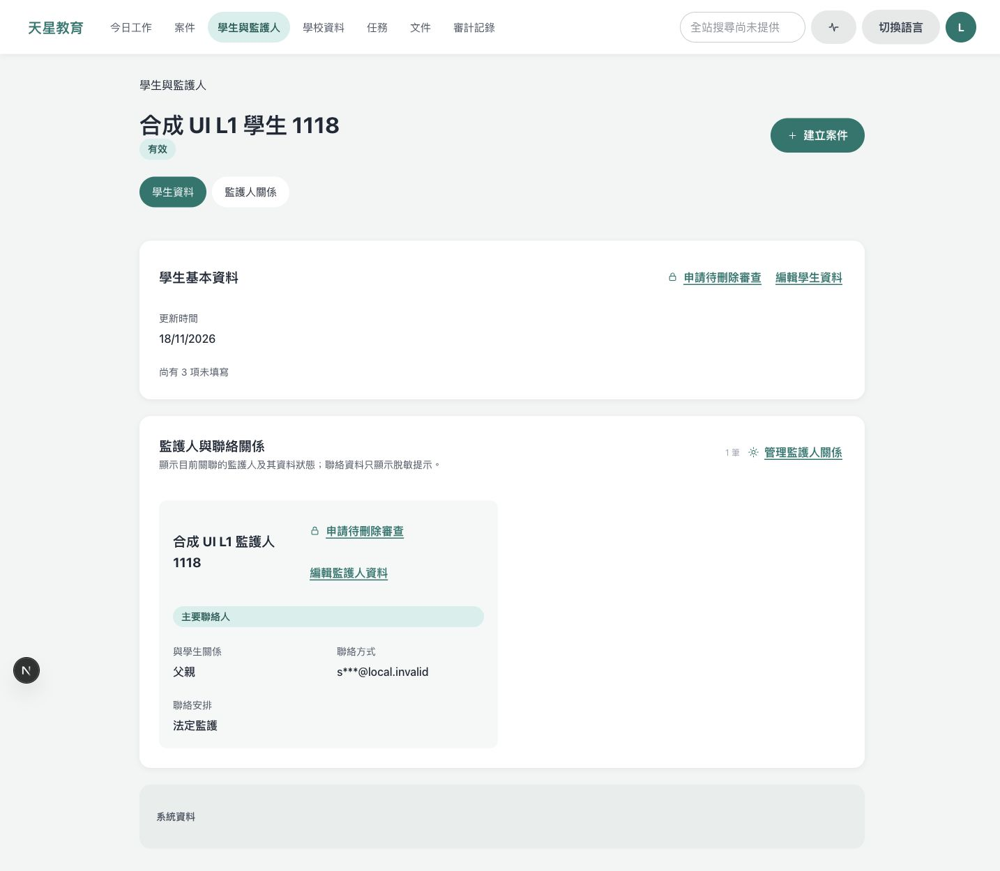

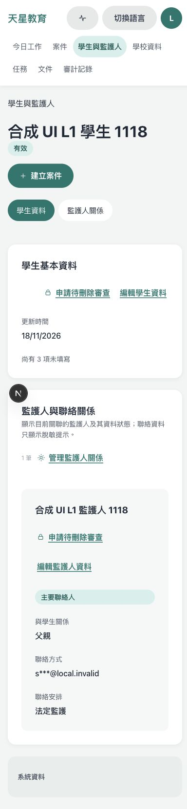

### 学生详情编辑态

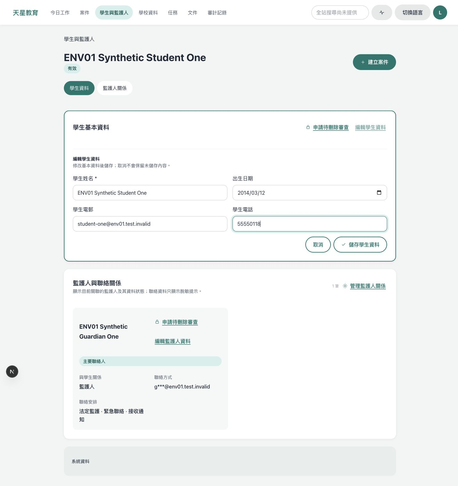

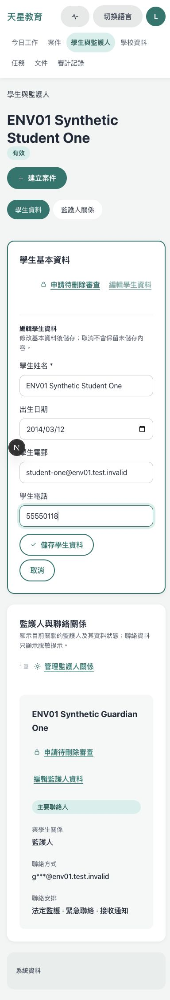

### 新建表单

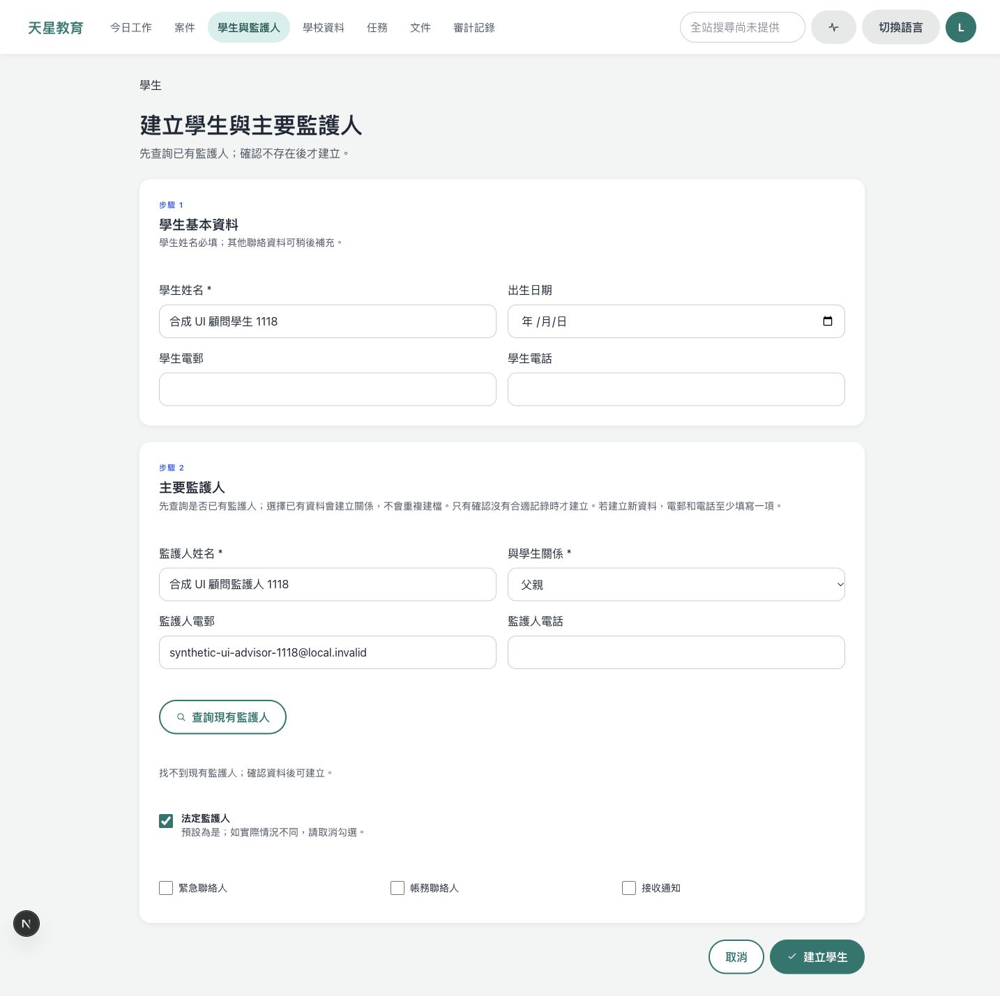

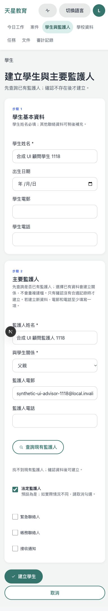

### 监护人关系

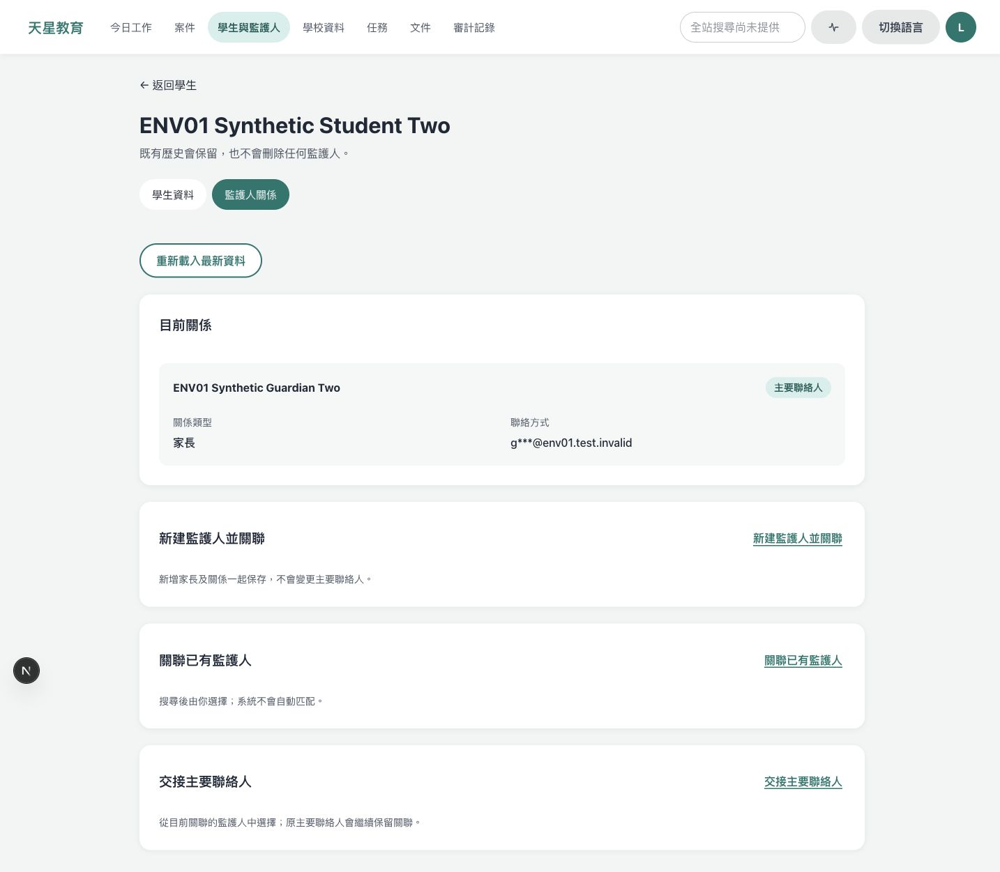

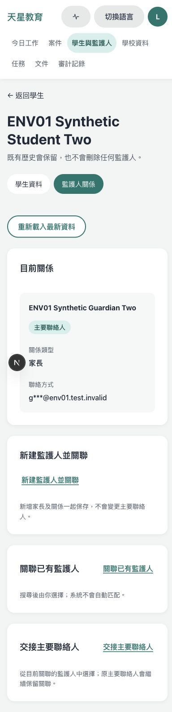

### 疑似重复（原有404）


### 推荐来源列表（空状态）

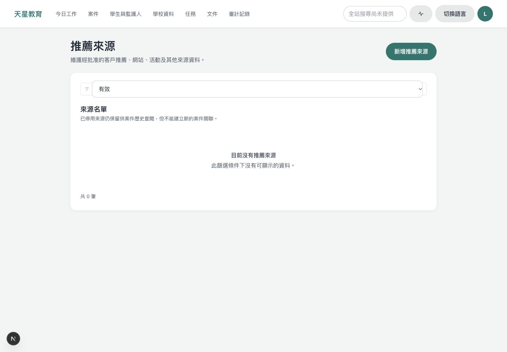

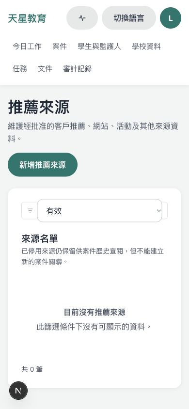

### 零缺项文字：改前／改后


### 查看任务按钮：改前／改后

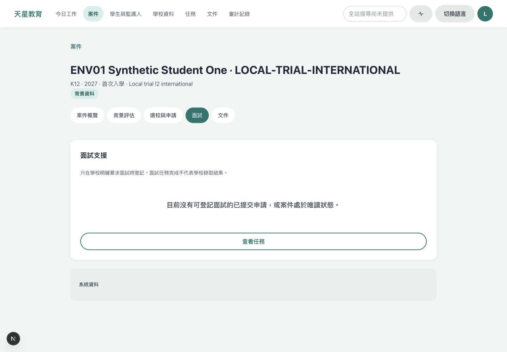

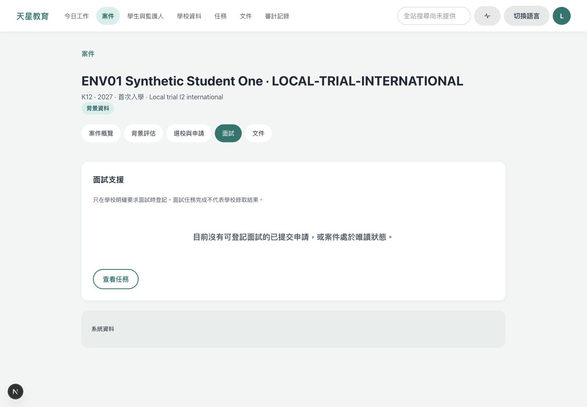

### 文件状态标签：改前／改后

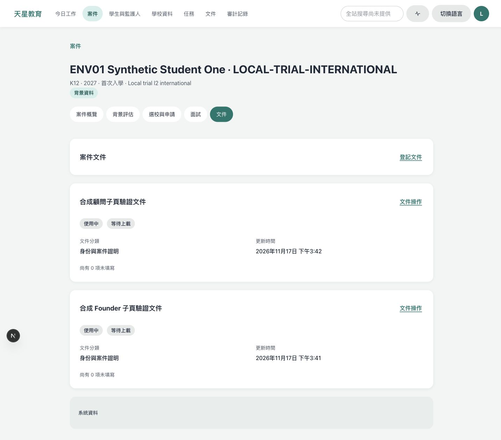

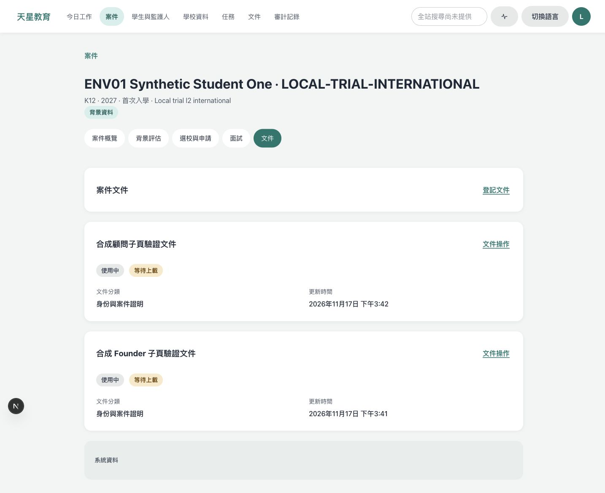

## 9. 自己点一遍与收尾

1. 浏览器打开 `http://localhost:3000/login`，使用上述 L1 或顾问合成账号和本地密码登录。本票结束时应用保持运行；没有改认证机制。
2. 打开 `/students` 查看表格和条数。搜索、状态筛选存在上述既有接口问题，不应把结果当作已过滤。
3. L1 可打开“合成 UI L1 學生 1118”；顾问可打开原有合成学生 One。点卡标题右侧“編輯學生資料”，改可编辑项后“儲存學生資料”；确认成功提示和刷新后的值。
4. 点“監護人關係”看现有关系与折叠的管理表单；系统编号在页底“系統資料”展开查看。
5. `/students/new` 保留原建档流程；L1 已验证成功，顾问提交会被拒绝。不要为重看样式重复建档。
6. `/referral-sources` 当前为空；`/students/deletion-requests` 对 L1 是空队列，对顾问是拒绝页；`/students/duplicates` 原有 404 保留。

收尾：仅保留运行中的本地 PostgreSQL 与应用；唯一 Docker 卷应为 `tianxing-local_tianxing_postgres_data`。本票基线比较副本、测试日志等临时文件在交付前删除。没有合并、建 PR、部署、远程数据库访问或真实网站访问；没有真实资料写入、真实学校资料使用；没有提交 AGENTS.md。
